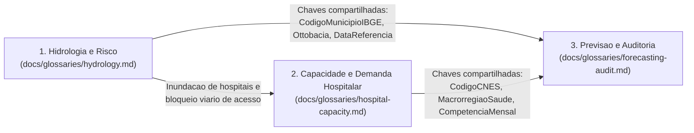

# GLOSSARY-MAP.md — Mapa de Contextos Delimitados

O domínio de `Previsao-de-leitos` atravessa três contextos distintos que se conectam por chaves territoriais e temporais compartilhadas. Cada contexto possui glossário próprio, sem detalhes de implementação.

## Contextos e Glossários

1. **[Hidrologia e Risco de Enchentes](docs/glossaries/hydrology.md)** — precipitação em grade, saturação do solo, cotas fluviométricas, bacias hidrográficas, extensão inundada por satélite e decretos administrativos de desastre.
2. **[Capacidade e Demanda Hospitalar](docs/glossaries/hospital-capacity.md)** — hospitais-escola, categorias de leitos CNES, demanda por internação (SIH-SUS), tempo de permanência (LOS), macrorregiões de referência e *surge capacity*.
3. **[Previsão, Calibração e Auditoria](docs/glossaries/forecasting-audit.md)** — origem da previsão, horizonte, covariáveis *ex-ante* vs. *ex-post*, holdout intocado, calibração probabilística e resíduos contrafactuais.
