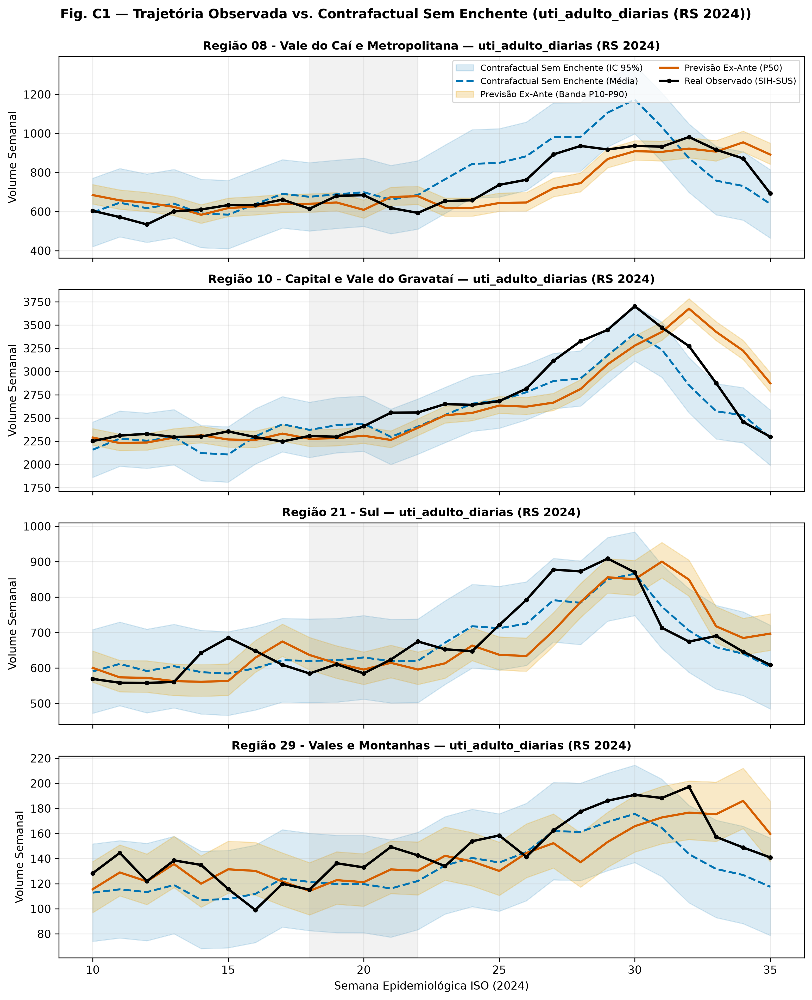
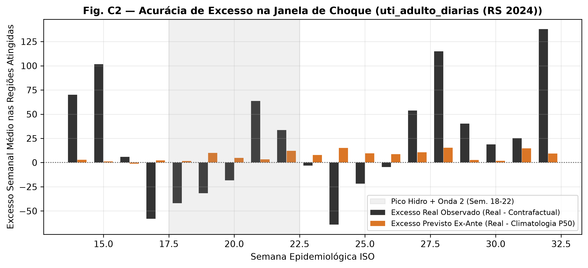
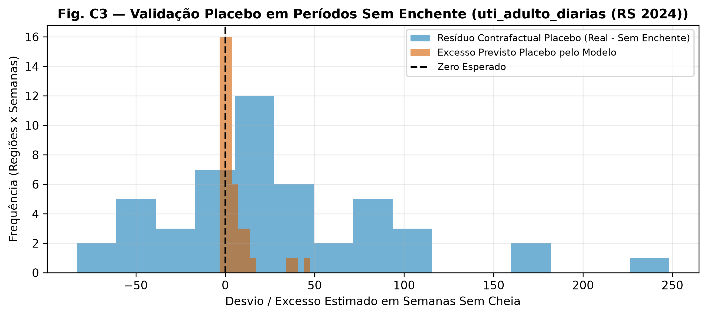
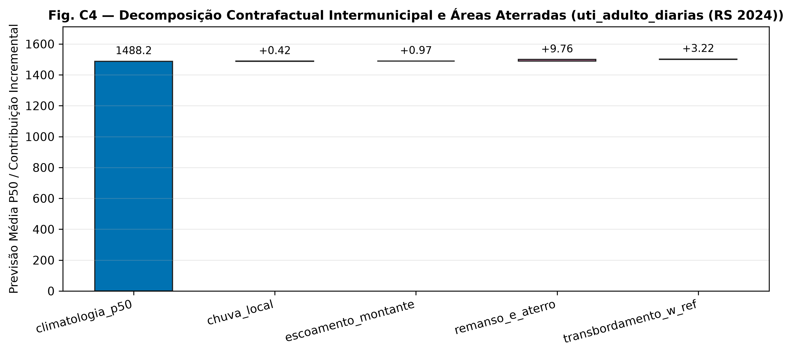
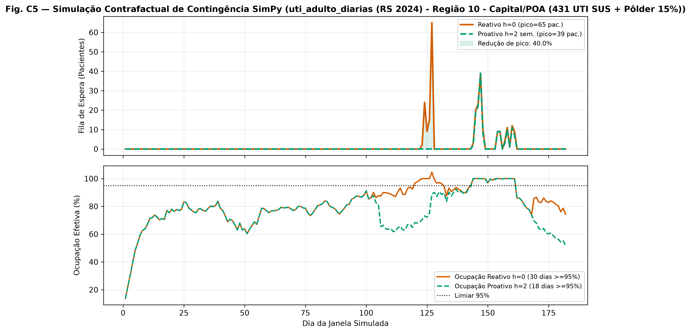

# Relatório de Verificação Científica - uti_adulto_diarias (RS 2024) (`rs_v1_4_0_m1`)

> **Aviso de Escopo e Fronteira Clínica:** Pesquisa aberta exclusivamente para avaliação metodológica e planejamento agregado (Not for patient care or live clinical use).

- **Execução (`run_id`):** `rs_v1_4_0_m1` | **Commit:** `cf18ef6` | **Seed:** `42`
- **Partições Congeladas (`ADR-0003`):** Treino `<= 2022` | Avaliação `2024` | Holdout Intocado `2025`

---

## 1. Metodologia Científica e Contratos Causais

- **Unidade de Análise e Horizonte:** Série semanal ISO por Região de Saúde do RS (`30/30`), com previsão estritamente *ex-ante* ($h = 2$ semanas / D+14, lags `0..4` semanas), separando Onda 1 (`D+0-5`) de Onda 2 (`D+7-28`: leptospirose/SRAG).
- **Integridade de Grade e Zero Vazamento (`ADR-0003`):** Grade calendário contínua sem compressão de lacunas (`null` != `0.0 mm`); escaladores, controle sintético, matriz `W_ref` e uso do solo `MapBiomas` ajustados estritamente em `<= 2022`.
- **Áreas Aterradas e Escoamento Intermunicipal (`ADR-0001` e `ADR-0006`):**
  - Restrição monotônica estrutural no `QuantileGBDTForecaster` (`0,00%` violações);
  - Grafo hidrológico ponderado com tempo de trânsito (`travel_weeks=1` Guaíba -> Lagoa dos Patos/Pelotas) e remanso lagunar sob vento Sul (`V10M`);
  - Exposição em áreas aterradas/pôlderes (`MapBiomas <= 2022`) e grafo assistencial intermunicipal `W_ref` (`MUNIC_RES -> CNES`).
- **Identificação Contrafactual (`ADR-0007`):** Controle Sintético independente sobre regiões-doadoras não inundadas para auditar excesso real vs. excesso previsto, validado por testes placebo em semanas calmas e decomposição sequencial `do(...)`.

---

## 2. Ferramentas, Versões e Ambiente Reprodutível

- **python:** `3.12.16`
- **polars:** `2.1.0`
- **numpy:** `2.4.6`
- **scipy:** `1.17.1`
- **scikit-learn:** `1.9.1`
- **statsmodels:** `0.15.0`
- **matplotlib:** `3.11.2`
- **Manifesto estruturado:** `run_manifest.json`

---

## 3. Datasets Utilizados e Auditoria LGPD

| Dataset | Período | Linhas | Nulos | LGPD (Zero PII) | Observação |
| --- | --- | --- | --- | --- | --- |
| Painel Semanal RS v2 (SIH+CNES+NASA POWER+MapBiomas+W_ref) | 2010-2025 | 25,020 | 0 | OK | ECE_surge=0.094 | BSS_surge=-0.011 |

---

## 4. Benchmark Comparativo de Acurácia (`2024`)

| modelo | mae_p50 | mae_persistencia | mae_sazonal | mase_vs_pers | mase_ci95_low | mase_ci95_high | mase_vs_saz | pinball_p50 | pinball_p90 | pinball_p95 | cobertura_p10_p90 |
| --- | --- | --- | --- | --- | --- | --- | --- | --- | --- | --- | --- |
| QuantileGBDT (Monotonic) | 24.343 | 24.949 | 40.275 | 0.976 | 0.951 | 0.997 | 0.604 | 12.172 | 6.816 | 4.737 | 0.712 |
| QuantileGBDT (Monotonic) + Conformal(2023) | 24.343 | 24.949 | 40.275 | 0.976 | 0.951 | 0.997 | 0.604 | 12.172 | 6.816 | 4.737 | 0.712 |

---

## 5. Análise Contrafactual Estruturada e Gráficos de Verificação

| Métrica Contrafactual | Valor Observado | Interpretação |
| :--- | :---: | :--- |
| **MAE do Excesso na Janela de Choque** | `67.22` | Erro médio entre excesso real e excesso previsto *ex-ante* |
| **Viés do Excesso no Choque** | `+1.69` | Positivo = superestimação; negativo = subestimação |
| **Erro de Timing de Pico (semanas)** | `3.75 sem.` | Aderência temporal do pico previsto ao pico observado |
| **Cobertura Empírica (P10-P90 no Choque)** | `50.0%` | Calibração da banda preditiva de `80%` durante o choque |
| **Viés Placebo (Semanas Sem Enchente)** | `+27.77` | Próximo de zero confirma ausência de falsos picos |
| **MAE Placebo (Semanas Sem Enchente)** | `48.86` | Ruído basal do controle sintético fora do desastre |
| **Taxa de Violação Monotônica** | `0.00%` | Alvo `0,00%` sob perturbação positiva de risco físico |

### Decomposição Contrafactual (`do(...)` - Intermunicipal e Áreas Aterradas)

| etapa | nivel_medio | contribuicao_delta |
| --- | --- | --- |
| climatologia_p50 | 1488.158 | 0.000 |
| chuva_local | 1488.582 | 0.424 |
| escoamento_montante | 1489.553 | 0.971 |
| remanso_e_aterro | 1499.310 | 9.758 |
| transbordamento_w_ref | 1502.532 | 3.221 |

### Gráficos Contrafactuais Gerados

- **Fig. C1 (Trajetória Observada vs. Contrafactual Sem Enchente vs. Previsão):**
  
- **Fig. C2 (Excesso Real vs. Excesso Previsto na Janela de Choque):**
  
- **Fig. C3 (Validação Placebo em Períodos Sem Enchente):**
  
- **Fig. C4 (Decomposição Waterfall Intermunicipal e de Áreas Aterradas):**
  

### Contrafactual Operacional Hospitalar (`SimPy`: `h=2` sem. vs. `h=0`)

| Política Simulada | Pico de Fila (Pac.) | Dias >=95% | Espera Média (h) | Eletivas Adiadas |
| :--- | :---: | :---: | :---: | :---: |
| **Reativo (`h=0`)** | `65` | `30` | `0.9` | `566` |
| **Proativo (`h=2` sem.)** | `39` | `18` | `0.6` | `902` |

- **Redução no pico de fila:** `40.0%` | **Dias de sobrecarga evitados:** `12`
- **Fig. C5 (Contrafactual de Contingência SimPy):**
  

### Análise de Curva de Decisão (Net Benefit - Acionamento de Contingência)

| limiar_pt | net_benefit_modelo | net_benefit_tratar_todos | net_benefit_tratar_nenhum |
| --- | --- | --- | --- |
| 0.100 | 0.171 | 0.160 | 0.000 |
| 0.200 | 0.109 | 0.054 | 0.000 |
| 0.300 | 0.058 | -0.081 | 0.000 |
| 0.400 | 0.022 | -0.261 | 0.000 |
| 0.500 | 0.004 | -0.513 | 0.000 |

---

## 6. Governança Científica (Resumo TRIPOD+AI / PROBAST+AI / RECORD)

| Eixo de Governança | Critério Verificado | Status |
| :--- | :--- | :---: |
| **Fronteira Clínica** | Pesquisa aberta e planejamento agregado (Not for patient care or live clinical use) | ✅ Conforme |
| **Privacidade (LGPD / RECORD)** | Zero PII de pacientes; agregação na fronteira BigQuery + supressão `n < 5` | ✅ Conforme |
| **Risco de Viés (PROBAST+AI)** | Splits congelados (`<= 2022` treino, holdout `2025` protegido), grade calendário sem compressão | ✅ Conforme |
| **Coerência Física (ADR-0001/0006)** | Restrição monotônica auditada (`0,00%`), aterros/pôlderes e acoplamento `G_hydro + G_health` | ✅ Conforme |
| **Reprodutibilidade (TRIPOD+AI)** | `run_manifest.json` com versões exatas, `git_sha`, seed determinística e 5 gráficos contrafactuais | ✅ Conforme |
