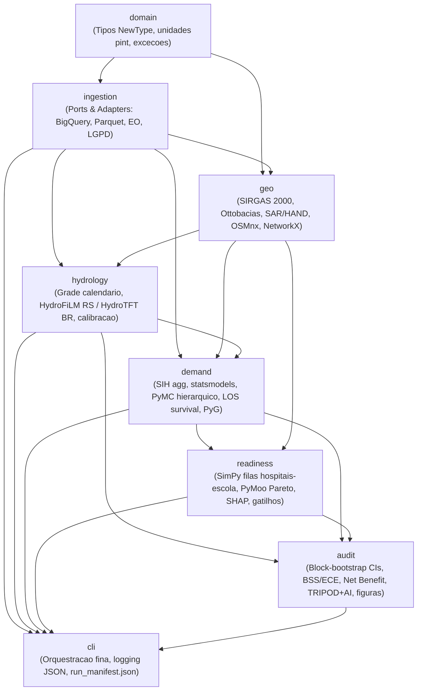

# Mapa de Capacidades (`spec/capability-map.md`) — Fase 0

> **Ponto de Aprovação:** Este documento define os limites modulares, a ordem de construção acíclica e a fronteira entre **V1 (RS Hospitais-Escola)** e **V2 (Escala Nacional — Brasil)**. Cada módulo receberá uma especificação individual `spec/SPEC-<id>.md` após aprovação deste mapa e da seleção de bases de dados ([docs/data-catalog.md](../docs/data-catalog.md)).

---

## 1. Objetivo do Sistema e Abordagem Mista

Prever, com antecedência acionável (*ex-ante*) e incerteza calibrada ($P_{50}/P_{90}/P_{95}$), a **necessidade de leitos hospitalares por especialidade específica — UTI Adulto, UTI Pediátrica/Neonatal, Clínico e Cirúrgico — e de contingência (*surge capacity*) em hospitais-escola e suas macrorregiões de saúde**, respondendo à pergunta central: *"diante de um evento climático extremo nesta semana $t$, quantos leitos por especialidade serão necessários em $t+1, t+2, t+3$ e $t+4$ semanas (foco principal em $h = 2$ semanas / D+14)?"*

- **V1 (Escopo Inicial — RS):** Rio Grande do Sul (497 municípios, 7 Macrorregiões de Saúde, bacias hidrográficas críticas e rede de hospitais-escola do RS), distinguindo explicitamente heterogeneidade regional (Região Metropolitana de Porto Alegre / Guaíba / Vales vs. Norte/Serra mais alto) e separando **Onda 1** (D+0 a D+5: trauma, crônicos, evacuações) de **Onda 2** (D+7 a D+28: leptospirose, doenças hídricas e SRAG).
- **V2 (Expansão Posterior — Brasil):** 27 UFs, 5.570 municípios e rede nacional de hospitais universitários/ensino (EBSERH e certificados MEC/MS), com horizontes multi-escala (15d a 180d) adaptados por bioma.

### Pilares da Abordagem Mista (Dados + Modelagem + Entrega)
1. **Dados em Duas Trilhas (Incremental):**
   - *Trilha 1A (Núcleo Semanal RS — entrega imediata):* `CNES (estabelecimento + leito + estabelecimento_ensino)` + `SIH-SUS (agregado semanal sem PII)` + `SINAN (Leptospirose/hídricas)` + `MERGE-CPTEC (100% RS)` + `ANA HidroWeb / Ottobacias` + `S2iD FIDE` + `MapBiomas` + `IBGE/Macrorregiões`.
   - *Trilha 1B (Enriquecimento Físico e Fila Reprimida — acoplada sem bloquear 1A):* `GERINT-POA` (solicitações/fila real na capital), `ERA5-Land` (umidade do solo + temperatura), `Sentinel-1 SAR / HAND` (inundação física e relevo) e `OSMnx` (bloqueios viários).
2. **Modelagem Híbrida (Física + Estatística/Bayesiana + Simulação):**
   - *Hidrologia:* redes profundas com monotonicidade estrutural (`HydroFiLMMonotonicNet` RS / `HydroTFTNet` BR) + propagação montante→jusante.
   - *Demanda Semanal (Horizonte 1–4 semanas):* modelos com **Defasagem Distribuída (*Distributed Lags*)** (`statsmodels` NegBin/Hurdle + `scikit-learn` Quantílico $P_{50}/P_{90}/P_{95}$ + `PyMC` Hierárquico por Hospital-Escola/Macrorregião) + tempo de permanência (**LOS**) via `scikit-survival`.
   - *Prontidão:* simulação de filas hospitalares (`SimPy`) convertendo chegadas + LOS em leitos de contingência e adiamento de eletivas.
3. **Entrega em Fatia Vertical (*Tracer Bullet*):** validar primeiro o pipeline semanal fim a fim da Trilha 1A (com baselines de defasagem distribuída por UTI específica e Macrorregião RS) antes de adicionar complexidade de GNN/SAR/otimização.

> **Fronteira Clínica:** Sistema de pesquisa e planejamento agregado (*"Not for patient care or live clinical use"*). Zero PII; conformidade LGPD na fronteira de dados.

---

## 2. Módulos e Grafo Acíclico de Dependências (Build Order)

| Ordem | Module ID | Responsabilidade (Módulo Profundo) | Costura / Adaptadores Reais | V1 (RS) | V2 (Brasil) |
| :-: | :--- | :--- | :--- | :---: | :---: |
| 1 | `domain` | Tipos de domínio (`CodigoCNES`, `CodigoMunicipioIBGE`, `CodigoUF`, `CompetenciaMensal`), unidades físicas (`pint`), hierarquia de exceções e validação de fronteira. | Nenhuma (in-process puro) | Obrigatório | Mantido |
| 2 | `ingestion` | Conectores parametrizados (BigQuery `basedosdados`, ANA/MERGE/STAC) + cache atômico por hash + contratos `pandera`/`polars` + agregação LGPD com supressão de pequenas células. | `TabularSourcePort`: `BigQueryAdapter` + `ParquetFixtureAdapter` | Obrigatório (RS) | Escala 27 UFs (`dask`/`polars`) |
| 3 | `geo` | Geometria métrica (`SIRGAS 2000`), grafo hidrológico intermunicipal ponderado com tempo de trânsito (`Ottobacias ANA BHO v6` + remanso lagunar por vento Sul), exposição em **áreas aterradas/pôlderes** (`MapBiomas` banhado→urbano + `HAND` + `GeoPOA/GeoPelotas` + `IPH/UFRGS Zenodo`), grafo assistencial causal (`W_ref`: `MUNIC_RES → CNES`) e cortes viários (`OSMnx`). | `HydroSourcePort` (`NasaPower` + `OpenMeteoEra5` + `Fixture`) + `SpatialCatalogPort` | Obrigatório (RS: 30 Regiões / 497 mun.) | Escala nacional (5.570 mun. + biomas) |
| 4 | `hydrology` | Grade diária sem lacunas, API vetorizado, `HydroFiLMMonotonicNet` (RS) / `HydroTFTNet` (BR) em `pytorch-lightning` com monotonicidade estrita, calibração pós-hoc e benchmarks `aeon`/`TimesFM 2.5`. | `FloodForecaster` (`fit`/`predict`/`calibrate`) | `HydroFiLMMonotonicNet` + baselines | `HydroTFTNet` multi-escala (15d–180d) |
| 5 | `demand` | Modelagem *ex-ante* de internações (`SIH-SUS` + `SINAN`) e tempo de permanência (LOS via `scikit-survival`), baselines `statsmodels`/`scikit-learn` quantil, modelo hierárquico `PyMC` (`Hospital-Escola ⊂ Macrorregião`) e Hetero-GNN (`PyG` na V2). | `DemandForecaster` + `LosSurvivalModel` | `statsmodels` + `scikit-learn` + `PyMC` + `scikit-survival` | + `torch-geometric` Hetero-GNN spillover |
| 6 | `readiness` | Simulação de filas hospitalares (`SimPy`: emergência/enfermaria/UTI, adiamento de eletivas, *lead time* 24–72h), explicabilidade `SHAP`, análise estruturada de cenários extremos e otimização Pareto (`pymoo` na V2). | `HospitalQueueSimulator` + `SurgeOptimizer` | `SimPy` + `SHAP` + cenários extremos | + `pymoo` (NSGA-II/III) alocação federal |
| 7 | `audit` | Avaliação estatística rigorosa (*block-bootstrap* por bacia/episódio, ECE, BSS, MASE, Pinball Loss, Net Benefit), **análise contrafactual estruturada** (controle sintético "sem enchente", testes placebo, acurácia de excesso/timing e intervenções `do()` intermunicipais/aterros), **5 gráficos contrafactuais acessíveis WCAG 2.2** e gerador automático do **Relatório de Verificação Científica** (metodologia, ferramentas, datasets, `run_manifest.json` e TRIPOD+AI / PROBAST+AI / RECORD). | Nenhuma (computação pura sobre resultados e manifestos) | Auditoria RS 2024 + Relatório Final Holdout 2025 | + CV espacial *Leave-UF/Basin-Out* + Relatório V2 |
| 8 | `cli` | Ponto de entrada único (CLI + uso limpo em Colab), configuração por ambiente, logging JSON estruturado (`run_id`, `entry_point`, `git_sha`) e execução reprodutível via `datalad run`. | Composição raiz | Obrigatório | + jobs GPU remotos (`modal`) |

---

## 3. Fora de Escopo na V1 (*Out of Scope — Deferred*)

- API REST/dashboard em tempo real conectado a prontuários ou centrais de regulação ao vivo (proibido pela fronteira clínica de pesquisa).
- Ingestão de microdados identificáveis de pacientes (PII) ou modelos de triagem individual.
- Treinamento distribuído multi-GPU e otimização multiobjetivo federal (`pymoo` 27 UFs) — reservados para a V2 após aprovação do Gate 3 (V1 RS validada no holdout 2025).
- Descontinuação de `previsao_leitos.py` antes que os testes de paridade e cobertura $\ge 80\%$ estejam verdes na Etapa 1.
